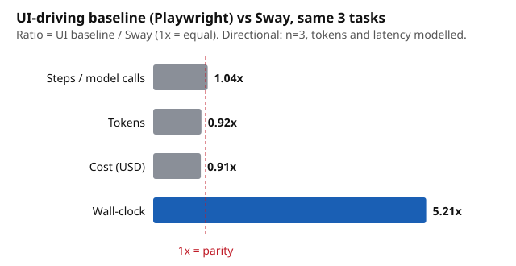

# Sway vs a UI-driving agent (directional)

**Read this first.** 3 tasks, 1 scenario each, one model. Treat every ratio as directional, not a benchmark. Token counts and LLM latency are **modelled**, not measured, because the committed call cache stores model text only. The UI side is a **UI-driving baseline (Playwright)**: a scripted click-through of a local mock shop. It is a stub, not a Kernel integration, and no LLM drives it.

Raw data: `results/20261106-233223/comparison.json`. Reproduce with `python compare_ui.py` (no live model calls; a cache miss aborts).

## Result

Ratios are UI baseline divided by Sway (1x = equal).

| Metric (3 tasks summed) | Sway | UI-driving baseline (Playwright) | UI / Sway |
|---|---|---|---|
| Steps (model calls) | 75 | 78 | 1.04x |
| Tokens | 83,754 | 76,692 | 0.92x |
| Wall-clock | 436 s | 2275 s | 5.21x |
| Cost (USD) | $0.105 | $0.095 | 0.91x |

Per task (Sway / UI baseline):

| Task | Steps | Tokens | Wall-clock | Cost |
|---|---|---|---|---|
| running-shoes | 25 / 26 | 27,326 / 25,496 | 146 s / 758 s | $0.034 / $0.032 |
| office-chair | 25 / 26 | 28,690 / 25,802 | 146 s / 758 s | $0.036 / $0.032 |
| backpack | 25 / 26 | 27,738 / 25,394 | 146 s / 758 s | $0.035 / $0.032 |

## What this does and does not show

- **No token or cost advantage.** Sway uses about as many steps and tokens as the UI baseline (UI is 0.92x Sway's tokens, so the UI side is slightly cheaper). Unlike the WebMCP post's savings, we have no efficiency win to claim here.
- **Wall-clock is the only gap (5.21x), and it is structural.** Sway's 25 ablation calls are independent and run 6 at a time (5 sequential waves). A UI agent's steps depend on each other, so they run one after another. The absolute seconds rest on one latency assumption below.
- **Not like for like.** The UI baseline only buys the item. Sway re-decides the purchase with each page removed to check whether the deciding page is honest. Sway is a verification layer, so the fairer reading is the cost of the check, not a replacement for the shopping agent. The UI baseline detects nothing about page manipulation.
- **The UI baseline is scripted.** It completed checkout on Sway's clean pick in 3/3 tasks. A real LLM-driven UI agent would add misclicks, retries and longer histories, so its true step and token counts are likely higher than shown.

## Method

- **Tasks:** running-shoes, office-chair, backpack. Sway side is the `clean` condition, k=5, top-5 Channel3 results, replayed from the pinned run `20261106-223707` through the on-disk call cache (0 new model calls).
- **Sway tokens:** characters of every system+user prompt and response replayed, divided by 4.
- **UI baseline steps:** search, then open and go back from each of 5 products and 4 research pages, open the pick, add to cart, checkout, address, place order. Each step is counted as one LLM call carrying the page snapshot (visible text and clickable elements) plus a 400-token instruction block and growing history, and emitting 60 tokens.
- **Latency:** 29.1 s per model call, derived from the pinned run (1328 s x 6 workers / 274 calls). It likely overstates real API latency (it includes CLI start-up) and applies equally to both sides. Measured Playwright browser time is small and is in the JSON.
- **Cost:** Haiku-class list price assumed ($1 / $5 per million tokens in/out) for both sides. Absolute dollars depend on that guess; ratios do not.
- The AttriGuard/MELON baseline comparison is untouched.
